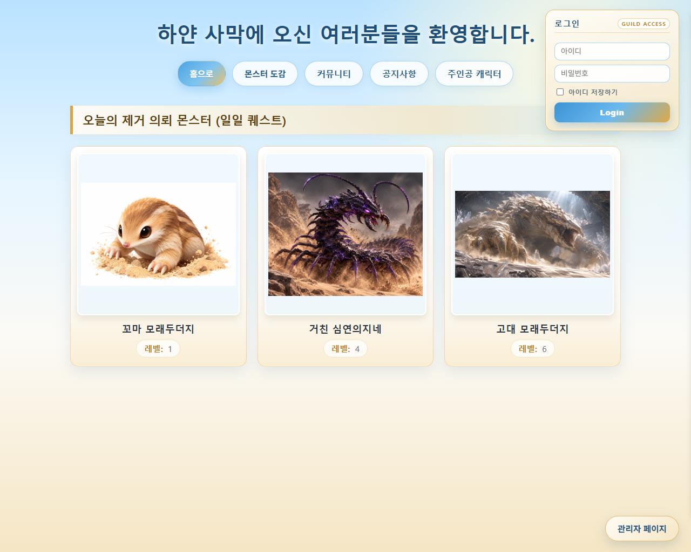

# 하얀 사막 | 몬스터 도감 & 커뮤니티


게임 세계관을 웹으로 탐험할 수 있도록 몬스터 도감, 캐릭터 소개, 커뮤니티, 공지사항을 구현한 풀스택 프로젝트입니다. Vanilla JavaScript 프런트엔드와 FastAPI 백엔드를 연결하고, JSON 파일을 이용한 데이터 관리와 이미지 업로드 기능을 제공합니다.

몬스터 102종, 게시글 51건, 공지사항 25건, 주인공 캐릭터 4명의 샘플 데이터와 이미지를 포함합니다.

## 목차

- [주요 화면](#주요-화면)
- [핵심 기능](#핵심-기능)
- [구현 포인트](#구현-포인트)
- [기술 스택](#기술-스택)
- [아키텍처 개요](#아키텍처-개요)
- [프로젝트 구조](#프로젝트-구조)
- [설치 방법](#설치-방법)
- [설정 정보](#설정-정보)
- [주요 API](#주요-api)
- [트러블슈팅](#트러블슈팅)
- [향후 로드맵](#향후-로드맵)

## 주요 화면

### 메인 화면


- 하얀 사막 소개 화면과 일일 퀘스트용 몬스터 추천 카드를 표시합니다.
- 몬스터 도감, 커뮤니티, 공지사항, 주인공 캐릭터, 관리자 페이지로 이동할 수 있습니다.

### 몬스터 도감

- 몬스터 전체 목록을 표 형태로 제공합니다.
- 이름, 레벨, 서식지로 검색할 수 있습니다.
- 몬스터 이미지 클릭 시 원본 이미지를 모달로 확인할 수 있습니다.
- 레벨, 체력, 경험치, 공격력, 드랍 아이템, 설명 정보를 확인할 수 있습니다.

### 커뮤니티

- 추천 게시글과 최신 게시글을 카드형 목록으로 보여줍니다.
- 게시글 작성, 전체 목록 조회, 상세 조회, 수정, 삭제를 지원합니다.
- 게시글은 카테고리, 제목, 작성자, 내용으로 구성됩니다.
- 페이지네이션과 조회수, 추천수, 댓글 수 표시를 제공합니다.

### 공지사항

- 카테고리 필터와 제목/내용 검색을 지원합니다.
- 상단 고정 공지와 일반 공지를 구분합니다.
- 공지 작성, 상세 조회, 수정, 삭제와 조회수 증가를 지원합니다.
- 페이지당 항목 수와 페이지네이션을 제공합니다.

### 주인공 캐릭터

- 전사, 마법사, 은술사, 격투가 등 주인공 캐릭터를 카드로 보여줍니다.
- 캐릭터 이미지, 이름, 직업, 종족, 설명을 제공합니다.

### 관리자 페이지

- 몬스터 등록 및 드래그 앤 드롭 이미지 업로드를 지원합니다.
- 몬스터 전체 목록 모달에서 정보 수정과 삭제를 수행할 수 있습니다.

## 핵심 기능

| 기능 | 주요 내용 |
| --- | --- |
| 몬스터 도감 | 102종의 몬스터 조회, 이름·레벨·서식지 검색, 상세 정보와 이미지 확인 |
| 몬스터 관리 | 몬스터 등록·수정·삭제, 관리자 페이지에서 이미지 업로드 |
| 커뮤니티 | 추천·최신 게시글 조회, 게시글 작성·상세 조회·수정·삭제 |
| 공지사항 | 카테고리 필터와 검색, 상단 고정, 공지 CRUD |
| 캐릭터 소개 | 주인공 캐릭터의 이미지와 프로필 정보 조회 |
| API 문서 | FastAPI Swagger UI에서 API 명세 확인 및 요청 테스트 |

## 구현 포인트

- 프런트엔드에서 `fetch`로 FastAPI REST API를 호출해 화면 데이터를 표시합니다.
- 몬스터, 게시글, 공지사항 데이터를 JSON 파일로 관리하고 API를 통해 조회·변경합니다.
- 업로드한 이미지를 백엔드 정적 파일 경로로 제공해 브라우저에서 조회할 수 있도록 구성했습니다.
- 공지 조회수 저장과 Live Server 파일 감시가 맞물려 발생한 반복 새로고침 문제를 분석하고, 개발 서버 설정으로 해결했습니다.

## 기술 스택

| 구분 | 사용 기술 |
| --- | --- |
| Frontend | HTML5, CSS3, Vanilla JavaScript |
| Backend | Python, FastAPI |
| API 문서화 | Swagger UI / OpenAPI |
| 데이터 저장 | JSON 파일 |
| 이미지 제공 | FastAPI StaticFiles |
| 개발 도구 | VS Code, Live Server |

## 아키텍처 개요

```text
Browser / Live Server
        │
        │ HTTP Fetch
        ▼
FastAPI 서버 (127.0.0.1:8000)
        │
        ├─ /monsters
        ├─ /api/posts
        ├─ /api/notices
        └─ /api/pro
        │
        ▼
backend/storage/*.json
```

- 프런트엔드는 JavaScript `fetch`로 백엔드 REST API를 호출합니다.
- 몬스터 데이터는 메모리와 `white_desert_monsters.json`에 반영됩니다.
- 게시글과 공지사항은 대응하는 JSON 파일에 직접 읽기/쓰기를 수행합니다.
- 업로드된 몬스터 이미지는 `backend/storage/image/`에 저장되고 `/image` 경로로 제공됩니다.

## 프로젝트 구조

```text
Game_project/
├─ backend/
│  ├─ main.py                 # FastAPI 앱 생성 및 라우터 등록
│  ├─ routers/
│  │  ├─ monsters.py          # 몬스터 CRUD 및 이미지 업로드
│  │  ├─ posts.py             # 게시글 CRUD
│  │  ├─ notices.py           # 공지사항 CRUD 및 검색
│  │  └─ pro.py               # 주인공 캐릭터 조회
│  ├─ service/
│  │  └─ data.py              # 몬스터 데이터 로드 및 변경 로직
│  └─ storage/
│     ├─ *.json               # 서비스 데이터
│     └─ image/               # 몬스터 및 캐릭터 이미지
├─ frontend/withJS/
│  ├─ index.html              # 메인 화면과 몬스터 도감
│  ├─ admin/                  # 관리자 페이지
│  ├─ FromHome/
│  │  ├─ board/               # 커뮤니티 화면
│  │  ├─ notice/              # 공지사항 화면
│  │  └─ propage/             # 주인공 캐릭터 화면
│  ├─ css/
│  └─ js/
├─ docs/screenshots/          # README 주요 화면 캡처
├─ testcode/
└─ README.md
```

## 설치 방법

### 1. 저장소 복제

```bash
git clone https://github.com/WinterHodduck/Game_project.git
cd Game_project
```

### 2. Python 가상환경 및 패키지 설치

```bash
python -m venv .venv
.venv\Scripts\activate
pip install fastapi uvicorn pydantic python-multipart
```

### 3. 백엔드 실행

프로젝트 루트가 아닌 `backend` 폴더를 기준으로 실행합니다.

```bash
cd backend
uvicorn main:app --reload
```

실행 확인:

- <http://127.0.0.1:8000/>
- <http://127.0.0.1:8000/docs>

### 4. 프런트엔드 실행

VS Code에서 `frontend/withJS/index.html`을 열고 Live Server로 실행하거나, 정적 서버를 사용합니다.

```bash
cd frontend/withJS
python -m http.server 5500
```

브라우저에서 <http://localhost:5500/> 또는 Live Server 주소로 접속합니다.

## 설정 정보

현재 별도의 `.env` 파일은 사용하지 않습니다. 프런트엔드의 API 주소는 JavaScript 파일에 `http://127.0.0.1:8000` 또는 `http://localhost:8000`으로 지정되어 있습니다. 서버 주소나 포트를 변경할 때는 다음 파일의 API 주소도 함께 확인하세요.

- `frontend/withJS/js/data_api.js`
- `frontend/withJS/FromHome/board/`
- `frontend/withJS/FromHome/notice/notice.js`
- `frontend/withJS/FromHome/propage/pro.js`
- `frontend/withJS/admin/admin_create.html`

백엔드는 반드시 `backend` 디렉터리를 작업 위치로 두고 실행해야 JSON 및 이미지 경로가 올바르게 연결됩니다.

## 주요 API

| 기능 | Method | Endpoint |
| --- | --- | --- |
| 몬스터 전체 조회 | `GET` | `/monsters/` |
| 몬스터 검색 | `GET` | `/monsters/search?word=검색어` |
| 몬스터 단건 조회 | `GET` | `/monsters/{id}` |
| 몬스터 등록 | `POST` | `/monsters/` |
| 몬스터 수정 | `PUT` | `/monsters/` |
| 몬스터 삭제 | `DELETE` | `/monsters/{id}` |
| 몬스터 이미지 업로드 | `POST` | `/monsters/upload-image` |
| 게시글 목록 | `GET` | `/api/posts?page=1&size=10` |
| 추천 게시글 | `GET` | `/api/posts/best?limit=5` |
| 최신 게시글 | `GET` | `/api/posts/latest?limit=10` |
| 게시글 등록 | `POST` | `/api/posts` |
| 게시글 상세 조회 | `GET` | `/api/posts/{id}` |
| 게시글 수정 | `PUT` | `/api/posts/{id}` |
| 게시글 삭제 | `DELETE` | `/api/posts/{id}` |
| 공지사항 목록 | `GET` | `/api/notices?page=1&size=10` |
| 공지사항 상세 조회 | `GET` | `/api/notices/{id}` |
| 공지사항 등록 | `POST` | `/api/notices` |
| 공지사항 수정 | `PATCH` | `/api/notices/{id}` |
| 공지사항 삭제 | `DELETE` | `/api/notices/{id}` |
| 주인공 캐릭터 조회 | `GET` | `/api/pro/` |

API 요청 본문과 응답 예시는 실행 중인 서버의 `/docs`에서 확인할 수 있습니다.

## 트러블슈팅

### `ModuleNotFoundError: No module named 'fastapi'`

가상환경을 활성화한 뒤 FastAPI와 관련 패키지를 설치합니다.

```bash
pip install fastapi uvicorn pydantic python-multipart
```

### 프런트엔드에서 데이터가 조회되지 않음

백엔드가 `127.0.0.1:8000` 또는 `localhost:8000`에서 실행 중인지 확인합니다.

```bash
cd backend
uvicorn main:app --reload
```

브라우저 개발자 도구의 Network 탭에서 API 요청 실패 여부와 상태 코드를 확인합니다.

### Live Server에서 공지 상세 페이지가 반복 새로고침됨

#### 원인

공지 상세 정보를 조회하면 백엔드의 `get_notice()`가 조회수를 증가시키고 `backend/storage/notices.json`을 수정합니다. Live Server가 이 파일 변경을 감지해 페이지를 새로고침하면, 공지 요청과 파일 수정이 반복될 수 있습니다.

#### 해결 방법

조회수 기능은 유지하면서 Live Server의 감시 대상에서 공지 데이터 파일을 제외합니다. 프로젝트의 `.vscode/settings.json`에 다음 설정을 추가한 뒤 Live Server를 재시작하세요.

```json
{
  "liveServer.settings.ignoreFiles": [
    ".vscode/**",
    "**/*.scss",
    "**/*.sass",
    "**/*.ts",
    "**/backend/storage/notices.json"
  ]
}
```

`uvicorn --reload`는 별도 설정이 없다면 일반적으로 Python 파일 변경을 감시합니다. 이 문제는 Live Server의 파일 감시로 인해 발생하며, 배포 환경에서는 동일한 새로고침 루프가 발생하지 않습니다.

### CORS 오류 발생

프런트엔드에서 유효한 백엔드 주소를 호출하고 있는지 확인합니다. 브라우저 개발자 도구의 Console 및 Network 탭에서 요청 주소와 응답 상태를 확인하세요.

### JSON 데이터가 저장되지 않음

프로젝트의 `backend/storage/*.json` 파일에 쓰기 권한이 있는지 확인합니다. 게시글이나 공지사항 작성 후 실제 JSON 파일이 갱신되는지 확인할 수 있습니다.

### 이미지 업로드 후 이미지를 찾을 수 없음

이미지는 `backend/storage/image/`에 저장됩니다. 백엔드가 `backend` 폴더를 기준으로 실행 중인지 확인하고 `/image/{파일명}` 경로로 접근되는지 확인합니다.

## 향후 로드맵

- 환경변수를 통한 API 주소 및 포트 구성
- 로그인과 관리자 권한 인증 기능 구현
- JSON 파일 저장소를 데이터베이스로 전환
- 반응형 UI와 공통 컴포넌트 개선
- 자동화된 API 테스트 및 배포 환경 구성
